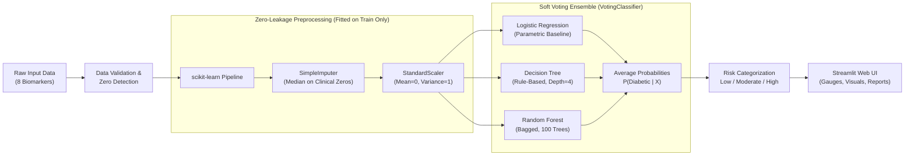

# 🩺 Diabetics Predictor — Soft Voting Ensemble Clinical Decision Support System

[](https://www.python.org/)
[](https://streamlit.io/)
[](https://scikit-learn.org/)
[](https://plotly.com/)
[](https://opensource.org/licenses/MIT)

An end-to-end Machine Learning web application that predicts diabetes risk using an interpretable **Soft Voting Ensemble (`VotingClassifier`)** combining three diverse machine learning algorithms. Built with a production-grade **scikit-learn `Pipeline`** with **zero data leakage**, real-time biomarker analysis against clinical guidelines, batch screening capabilities, and a modern medical-grade **Streamlit** user interface.

---

## 📌 Table of Contents

- [Project Overview](#-project-overview)
- [Key Features](#-key-features)
- [System Architecture & Pipeline](#-system-architecture--pipeline)
- [Machine Learning Ensemble](#-machine-learning-ensemble)
- [Dataset & Clinical Biomarkers](#-dataset--clinical-biomarkers)
- [Evaluation Metrics & Performance](#-evaluation-metrics--performance)
- [Web Application Walkthrough](#-web-application-walkthrough)
- [Project File Structure](#-project-file-structure)
- [Installation & Execution Guide](#-installation--execution-guide)
- [College Viva Voce & Interview Guide](#-college-viva-voce--interview-guide)
- [Ethical & Medical Disclaimer](#-ethical--medical-disclaimer)
- [Author & Acknowledgments](#-author--acknowledgments)

---

## 🔬 Project Overview

Diabetes Mellitus is a chronic metabolic disorder affecting hundreds of millions of individuals globally. Early risk assessment can significantly reduce the incidence of severe complications, including neuropathy, retinopathy, nephropathy, and cardiovascular disease.

This project delivers an interactive, interpretable clinical decision support system designed to assist healthcare educators, researchers, and students in exploring how multi-algorithmic machine learning models assess diabetic risk from standard patient laboratory biomarkers.

### Highlights:
- **Soft Voting Ensemble**: Fuses **Logistic Regression**, **Decision Tree Classifier**, and **Random Forest Classifier** into an ensemble that outputs calibrated class probabilities.
- **Zero Data Leakage Pipeline**: Imputation of missing physiological values and standard scaling are fitted strictly on the 80% training split inside a `Pipeline(ColumnTransformer)`.
- **Clinical Biomarker Interpretation**: Compares input values against established **American Diabetes Association (ADA)** and **World Health Organization (WHO)** normal and critical ranges.
- **Support for Both Sexes**: Accommodates male and female patient records (automatically locking pregnancies to zero for male profiles with demographic notes).
- **Batch Processing**: Supports batch patient screening via CSV upload with instant risk distribution visualization and export.

---

## ✨ Key Features

| Feature | Description |
| :--- | :--- |
| **Interactive Risk Gauge** | Visualizes diabetes probability with dynamic color zoning: Low (<30%), Moderate (30–60%), High (>60%). |
| **Model Voting Breakdown** | Transparently displays individual predictions and probability percentages from each of the three underlying classifiers. |
| **Biomarker Status Chips** | Real-time status tags (`Normal`, `Elevated`, `High`, `Critical`) for every clinical measurement based on medical thresholds. |
| **One-Click Clinical Presets** | Instant pre-population of inputs with *"Healthy Adult"*, *"Borderline"*, or *"High Risk"* profiles for quick demonstration. |
| **Downloadable Patient Report** | Generates a timestamped, formatted text report of the patient's inputs, predictions, risk factors, and clinical notes. |
| **Batch Screening** | Upload cohort CSV files, evaluate dozens of patients simultaneously, inspect risk distributions, and export scored results. |
| **Model Transparency & Insights** | Interactive confusion matrix, individual algorithm metrics comparison, Random Forest feature importance chart, and dataset statistics. |
| **Model Inspection CLI** | Standalone utility script (`inspect_model.py`) to inspect learned weights, thresholds, scaling factors, and tree depth. |

---

## 🏗️ System Architecture & Pipeline



### Why a Scikit-Learn Pipeline?
In real clinical data, evaluating test samples or new patients using statistics (mean/median/variance) computed over the entire dataset introduces **data leakage**, resulting in overly optimistic evaluation scores that fail in production. 

In this system:
1. `ColumnTransformer` applies `SimpleImputer(missing_values=0, strategy='median')` only to the features where zero represents missing data (`Glucose`, `BloodPressure`, `SkinThickness`, `Insulin`, `BMI`).
2. `StandardScaler()` scales all 8 features.
3. The imputer and scaler are fitted **exclusively on the 80% training split**. When new patient inputs arrive, frozen transformations are applied without refitting.

---

## 🤖 Machine Learning Ensemble

### 1. The Three Classifiers

1. **Logistic Regression (`LogisticRegression`)**:
   - Serves as the linear parametric baseline.
   - Provides smooth, continuous, and calibrated log-odds estimates across standardized features.
   - Regularized with $L_2$ penalty (`l2`) to avoid overfitting collinear medical indicators.

2. **Decision Tree Classifier (`DecisionTreeClassifier`)**:
   - A non-parametric, rule-based estimator.
   - Constrained with `max_depth=4` and `min_samples_leaf=5` to prevent memorization of small training subsets.
   - Captures orthogonal, non-linear cutoffs (e.g., elevated Glucose interacting with high BMI).

3. **Random Forest Classifier (`RandomForestClassifier`)**:
   - An ensemble of 100 bagged decision trees (`n_estimators=100`, `max_depth=5`, `min_samples_leaf=3`).
   - Uses bootstrap aggregation and random feature subsets to substantially reduce variance and prevent tree instability.

### 2. Combination Strategy: Soft Voting (`voting='soft'`)

Unlike **Hard Voting** (which simply takes a majority vote and ignores model confidence), **Soft Voting** calculates the weighted average of predicted class probabilities across all estimators:

$$P(\text{Diabetic} \mid X) = \frac{1}{3} \sum_{m=1}^{3} P_m(\text{Diabetic} \mid X)$$

$$\hat{y} = \begin{cases} 1 & \text{if } P(\text{Diabetic} \mid X) \ge 0.50 \\ 0 & \text{otherwise} \end{cases}$$

This gives high-confidence predictions appropriate weight and yields a continuous risk score (0% to 100%) that maps naturally to medical risk tiers.

---

## 📊 Dataset & Clinical Biomarkers

The model is trained on the benchmark **Pima Indians Diabetes Database** sourced from the **National Institute of Diabetes and Digestive and Kidney Diseases (NIDDK)**.

- **Total Records**: 768 patient instances
- **Target Distribution**:
  - `0` (Non-Diabetic): 500 instances (65.1%)
  - `1` (Diabetic): 268 instances (34.9%)
- **Split**: 80% Training (614 samples), 20% Held-Out Testing (154 samples), stratified by outcome.

### The 8 Clinical Input Features:

| Biomarker | Description | Unit | Normal Clinical Range | App Warning Threshold |
| :--- | :--- | :---: | :---: | :---: |
| **Pregnancies** | Number of times pregnant | count | 0 – 3 | Elevated if $\ge 4$ |
| **Glucose** | 2-hour oral glucose tolerance test plasma concentration | mg/dL | 70 – 99 (Fasting) / <140 (2-hr) | High if $\ge 140$, Critical if $\ge 200$ |
| **BloodPressure** | Diastolic blood pressure | mm Hg | 60 – 80 | High if $\ge 80$, Critical if $\ge 90$ |
| **SkinThickness** | Triceps skinfold thickness | mm | 10 – 25 | High if $> 30$ |
| **Insulin** | 2-Hour serum insulin | µU/mL | 16 – 166 | High if $> 166$, Critical if $> 250$ |
| **BMI** | Body Mass Index (weight in kg / height in $\text{m}^2$) | $\text{kg/m}^2$ | 18.5 – 24.9 | Overweight $\ge 25$, Obese $\ge 30$ |
| **DiabetesPedigreeFunction** | Genetic diabetes risk score based on family history | score | 0.08 – 0.50 | High genetic risk if $> 0.50$ |
| **Age** | Patient age | years | 21 – 81 | Increased screening risk if $\ge 45$ |

> [!NOTE]
> **Handling Biological Zeros:** In the raw dataset, a value of `0` in `Glucose`, `BloodPressure`, `SkinThickness`, `Insulin`, or `BMI` represents a missing measurement rather than a true biological value (a living human cannot have zero blood glucose or blood pressure). The pipeline automatically identifies these zeros and imputes them using the **training partition medians**.

---

## 📈 Evaluation Metrics & Performance

Evaluated on the independent, held-out test partition (**154 samples**, 20% stratified test set):

### Authentic Test Set Results:

| Metric | Voting Ensemble | Logistic Regression | Decision Tree | Random Forest |
| :--- | :---: | :---: | :---: | :---: |
| **Test Accuracy** | **71.43%** | 70.78% | 79.87% | 73.38% |
| **Precision (Diabetic)** | **61.90%** | 60.00% | 70.91% | 65.85% |
| **Recall (Diabetic)** | **48.15%** | 50.00% | 72.22% | 50.00% |
| **F1-Score** | **54.17%** | 54.55% | 71.56% | 56.84% |

### Test Confusion Matrix:

```text
                  Predicted Negative    Predicted Positive
Actual Negative          84 (TN)               16 (FP)
Actual Positive          28 (FN)               26 (TP)
```

- **True Negatives (TN = 84)**: Correctly identified healthy individuals.
- **False Positives (FP = 16)**: Healthy individuals flagged for further testing.
- **False Negatives (FN = 28)**: Diabetic individuals who were missed.
- **True Positives (TP = 26)**: Correctly identified diabetic patients.

> [!IMPORTANT]
> **Clinical Discussion on False Negatives:** In disease screening, False Negatives (FN) carry a higher clinical risk than False Positives (FP). The ensemble recall of 48.15% on this benchmark highlights why machine learning models must serve as **triage indicators** rather than definitive diagnostic tools, and why borderline/moderate risk tiers are explicitly surfaced in our interface.

---

## 🖥️ Web Application Walkthrough

The Streamlit web application is structured into three dedicated clinical tabs:

### 1. Tab 1: Assess a Patient
- **Demographic & Clinical Inputs**: Numeric sliders and step inputs with instant physiological range chips (`Normal`, `Elevated`, `Critical`).
- **Sex Selection**: Switches between Female and Male mode, automatically disabling and zeroing `Pregnancies` for male records while providing an explicit demographic limitation banner.
- **Presets**: 1-click test buttons for **"Healthy Adult"**, **"Borderline"**, and **"High Risk"** cases.
- **Risk Assessment Output**:
  - Radial risk gauge color-coded into Low, Moderate, or High Risk.
  - Three-bar comparative voting chart showing each algorithm's probability score.
  - Flagged risk factors and zero-imputation transparency notice.
  - One-click **Download Clinical Summary Report (.txt)**.

### 2. Tab 2: Batch Screening
- **Cohort Upload**: Upload any CSV dataset matching clinical columns.
- **Sample Template**: Downloadable `diapredict_template.csv` for standardized testing.
- **Batch Processing**: Computes predicted outcome, risk probability, and risk tier across hundreds of rows in milliseconds.
- **Summary KPIs**: Visual breakdown of total cohort volume, Low Risk count, Moderate Risk count, and High Risk count.
- **Export**: One-click download of the complete scored cohort (`diapredict_scored_*.csv`).

### 3. Tab 3: Model Insights
- **Live Metric Cards**: Authentic Accuracy, Precision, Recall, and F1-Score.
- **Confusion Matrix Heatmap**: Visual presentation of TN, FP, FN, and TP.
- **Multi-Algorithm Comparison**: Bar chart comparing Accuracy, Precision, Recall, and F1 across all models.
- **Feature Importance Chart**: Top predictors ranked by Gini importance from the Random Forest estimator (typically `Glucose`, `BMI`, and `Age`).
- **Architecture Diagram**: End-to-end transformation flow from raw inputs to calibrated risk scores.

---

## 📁 Project File Structure

```text
Diabetics-predictor/
├── .streamlit/
│   └── config.toml          # Custom theme configuration (clean medical palette)
├── app.py                   # Streamlit web application with all 3 tabs and visualizations
├── train_model.py           # Model training, zero-leakage pipeline, evaluation & export
├── inspect_model.py         # Diagnostic utility to inspect saved pipeline parameters
├── diabetes.csv             # NIDDK Pima Indians Diabetes dataset
├── model.pkl                # Serialized trained scikit-learn Pipeline (VotingClassifier)
├── metrics.json             # Serialized evaluation metrics and confusion matrix
├── requirements.txt         # Project dependencies
├── .gitignore               # Ignored cache, build, and OS files
└── README.md                # Comprehensive project documentation & viva guide
```

---

## 🚀 Installation & Execution Guide

### Prerequisites
- Python 3.9 or higher (Python 3.10, 3.11, 3.12, 3.13 supported)
- `git` installed on your system

### 1. Clone the Repository
```bash
git clone https://github.com/KAIZEN1503/Diabetics-predictor.git
cd Diabetics-predictor
```

### 2. Create and Activate a Virtual Environment
```bash
# Windows (PowerShell)
python -m venv venv
.\venv\Scripts\Activate.ps1

# Linux / macOS
python3 -m venv venv
source venv/bin/activate
```

### 3. Install Dependencies
```bash
pip install -r requirements.txt
```

### 4. (Optional) Re-Train the Ensemble Model
To retrain the VotingClassifier and regenerate `model.pkl` and `metrics.json`:
```bash
python train_model.py
```
*Output: Displays data inspection, missing zero counts, individual model metrics, ensemble evaluation, and saves serialized files.*

### 5. (Optional) Inspect the Saved Pipeline
To view the learned medians, scaling means, tree depths, and logistic coefficients inside `model.pkl`:
```bash
python inspect_model.py
```

### 6. Run the Web Application
Launch the Streamlit interface:
```bash
streamlit run app.py
```
Open your browser at **`http://localhost:8501`**.

---

## 🎓 College Viva Voce & Interview Guide

Here are standard questions frequently asked by professors, external examiners, and technical interviewers regarding this project:

<details>
<summary><b>Q1: Why did you use an Ensemble (VotingClassifier) instead of a single model?</b></summary>

> **Answer:** No single classifier is universally optimal across all medical datasets. Logistic Regression provides a calibrated linear baseline, Decision Trees uncover non-linear hierarchical decision rules, and Random Forests reduce variance via bagging. By combining them in a `VotingClassifier` with soft voting, the ensemble smooths individual estimator biases, reduces variance, and provides more stable probability estimates on unseen patient records.
</details>

<details>
<summary><b>Q2: What is the difference between Hard Voting and Soft Voting?</b></summary>

> **Answer:** 
> - **Hard Voting (Majority Rule):** Predicts the class label that received the majority of votes (e.g., if two models say Diabetic and one says Non-Diabetic, prediction is Diabetic). It ignores how confident each model was.
> - **Soft Voting (Average Probability):** Computes the arithmetic average of class probabilities across all estimators. It allows a model that is 95% confident to influence the decision more than a model that is only 51% confident, producing a smooth and calibrated risk score suitable for medical risk grading.
</details>

<details>
<summary><b>Q3: How did you prevent Data Leakage during preprocessing?</b></summary>

> **Answer:** Data leakage occurs when test set information contaminates model training. We prevented this by packaging preprocessing and modeling inside a scikit-learn `Pipeline`. The imputation medians for biological zeros and the standard scaling parameters ($\mu$ and $\sigma$) were calculated **strictly on the 80% training split**. The fitted pipeline then applies these exact frozen values to test samples and live web inputs without recomputing them.
</details>

<details>
<summary><b>Q4: Why did you replace zero values in Glucose, Blood Pressure, BMI, etc.?</b></summary>

> **Answer:** In physiological measurements, values of 0 mg/dL for glucose, 0 mm Hg for diastolic blood pressure, or 0 kg/m² for BMI are incompatible with life. In the Pima dataset, zeros represent missing or unrecorded clinical data. Dropping these rows would discard almost half the dataset. Replacing them with the training median preserves sample size while preventing distorted distributions.
</details>

<details>
<summary><b>Q5: How does the system handle male patients when the training dataset is female-only?</b></summary>

> **Answer:** The Pima Indians Diabetes Database consists exclusively of female patients of Pima heritage aged 21 and older. When assessing a male patient, our interface automatically locks `Pregnancies` to `0` and explicitly alerts the clinician that predictions for male patients or multi-ethnic cohorts are academic approximations that have not been clinically validated.
</details>

<details>
<summary><b>Q6: What does the Confusion Matrix tell us about clinical risk in this model?</b></summary>

> **Answer:** In our held-out test set of 154 patients, the model achieved 84 True Negatives, 26 True Positives, 16 False Positives, and 28 False Negatives. In clinical screening, False Negatives (missed diabetics) are dangerous because untreated diabetes leads to microvascular and macrovascular complications. That is why our application flags moderate risk starting at 30% probability and highlights key risk factors rather than simply giving a binary yes/no.
</details>

---

## ⚠️ Ethical & Medical Disclaimer

> [!CAUTION]
> **ACADEMIC DEMONSTRATION ONLY**  
> This software is developed strictly for **academic demonstration, machine learning education, and technical examination** in an undergraduate or graduate computer science curriculum.  
> 
> - It is **NOT** a certified medical diagnostic device.
> - It must **NEVER** be used for clinical diagnosis, treatment decisions, patient prescription, or professional medical advice.
> - Real medical diagnosis requires comprehensive physical examination, verified laboratory assays (e.g., venous HbA1c, fasting plasma glucose), and consultation with a licensed medical professional.

---

## 👨‍💻 Author & Acknowledgments

- **Developer:** [Aryan Mhaskar (KAIZEN1503)](https://github.com/KAIZEN1503)
- **Repository:** [https://github.com/KAIZEN1503/Diabetics-predictor](https://github.com/KAIZEN1503/Diabetics-predictor)
- **Dataset Source:** National Institute of Diabetes and Digestive and Kidney Diseases (NIDDK)
- **Frameworks:** [Streamlit](https://streamlit.io/), [scikit-learn](https://scikit-learn.org/), [Plotly](https://plotly.com/), [Pandas](https://pandas.pydata.org/)
